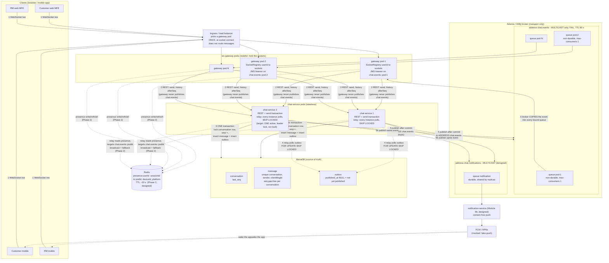

# Architecture diagram: RM <-> customer chat

Quick reference, technology-neutral enough to redraw in any tool. Status of each part is in the legend.
Sources: `docs/design-decisions.md` (D2-D17), `docs/chat-design.md` section 5, the slice code.

Presentation version (white background, 3840x2160): `docs/images/architecture-diagram-4k.png`; editable vector: `docs/images/architecture-diagram.svg`.
The Mermaid diagram below is the editable text form; its automatic layout is tangled, so use the image for slides.

## 1. Components and data flow

### Reading it in order (one message, customer -> RM)

| Step | What happens | Where |
|---|---|---|
| 1 | Customer's tab sends `{conversationId, clientMsgId, body}` on its socket | client -> gateway pod holding the socket |
| 2 | Gateway calls chat-service REST with the **authenticated** `userId` and the socket's `originSessionId` | gateway -> chat-service (through a load balancer) |
| 3 | One DB transaction: lock `conversation` row, `seq = last_seq + 1`, insert `message`, insert `outbox`. A repeat of the same `clientMsgId` returns the original ids (`duplicate: true`) | chat-service -> MariaDB |
| 3b | Reply `ack {messageId, seq}` goes back to the **origin socket only** (state `SENT`) | chat-service -> gateway -> client |
| 4-5 | Relay reads unpublished outbox rows (in `outbox.id` order), publishes each to address `chat.events`, then sets `published_at` | chat-service -> broker, MariaDB |
| 6 | Broker **copies** the event into every bound pod queue | inside the broker |
| 7 | Each pod: for every participant's local sockets, write the full message, **skip the origin socket**; pods with no socket for those users do nothing | gateway pod |
| 8 | Offline devices: the notification path sends a content-free push; on reconnect the client fetches history from MariaDB by `afterSeq` | notification-service, chat-service |

## 2. Names and settings to keep (copy into your own design)

| Thing | Name / setting | Why |
|---|---|---|
| Live-event address | `chat.events`, **multicast only**, address-full-policy `FAIL`, message TTL 60 s | pods are disposable; a stuck pod must not fill the broker |
| Pod queue | `chat.events::<podId>`, **non-durable**, `max-consumers 1`, purge-on-no-consumers | one consumer per pod; a second pod with the same name is rejected loudly; nothing to clean up after a crash |
| Publish destination | **topic** (JMS pub/sub) to the address, never to a queue | the broker does the fan-out |
| Notification address | `chat.notifications`, queue `notification`, **durable**, shared by all replicas | events must wait during a deploy; one replica per event |
| Pod id | stable and unique per running pod (`POD_ID`) | queue name comes from it |
| Event envelope | `eventId`, `eventType`, `schemaVersion`, `conversationId`, `participants` snapshot at commit, `originSessionId`, full message | consumers dedupe on `eventId` / `messageId` |
| Identifiers | `clientMsgId` UUID v4 (client), `messageId` UUID v7 (server), `seq` per conversation, `senderId` = authenticated user | D16 |

## 3. Rules the picture cannot show

- **MariaDB is the truth, the broker is transport.** A message exists only after its DB commit. Live delivery is an optimisation; the client's history fetch by `seq` is the safety net.
- **At-least-once everywhere.** Duplicates are normal (crash after publish, before `published_at`). Clients dedupe on `messageId`, order by `seq`.
- **The gateway never publishes chat events.** Only the relay does; otherwise a message could be delivered that was never committed.
- **Relay, slice vs target.** Slice (built): every chat-service instance runs the relay and takes different outbox rows with `SKIP LOCKED` (D7). That prevents two relays taking the same row, but **not** reordering across relays (pod B can publish seq 11 before pod A publishes seq 10). Target (D8, not built): one active relay chosen by a leader lock keeps per-conversation order, with `SKIP LOCKED` and consumer dedupe as the safety nets. Drill C8 measures the reordering.
- **Pod queues are per pod, never per user.** Broker objects grow with pods, not with the 50K users.
- **Redis is a hint, never the authority.** If it is down or empty, broadcast; "no presence entry" means unknown, not offline.

## 4. Legend: built or designed

| Part | Status |
|---|---|
| chat-service: send transaction, idempotency, outbox, relay, REST | **Built** (slice) |
| ws-gateway: socket registry, pod queue, event router, `/ws` | **Built** (slice) |
| `chat.events` broadcast to all pod queues | **Built** |
| Address settings (`FAIL`, TTL), `chat.notifications`, notification-service | Designed, not built |
| Redis presence and targeted routing | Designed (Phase 2), not built |
| Leader lock for the relay (D8; the slice runs a relay on every instance), heartbeat, reconnect protocol, auth | Designed, not built (failure drills will confirm the gaps) |
| Delivered / read events with several recipients and devices | **Open** (D18) |
