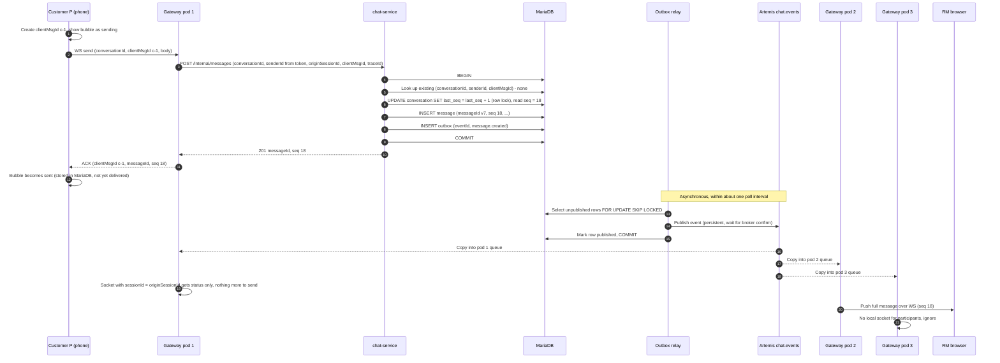
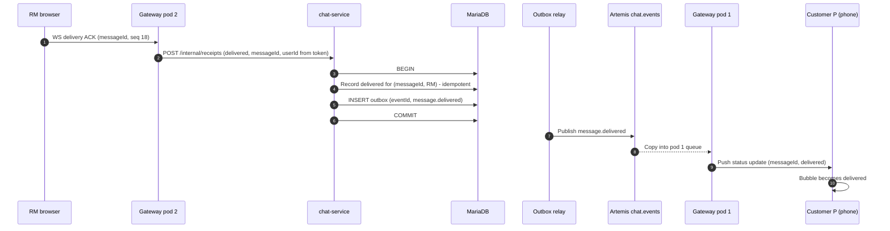
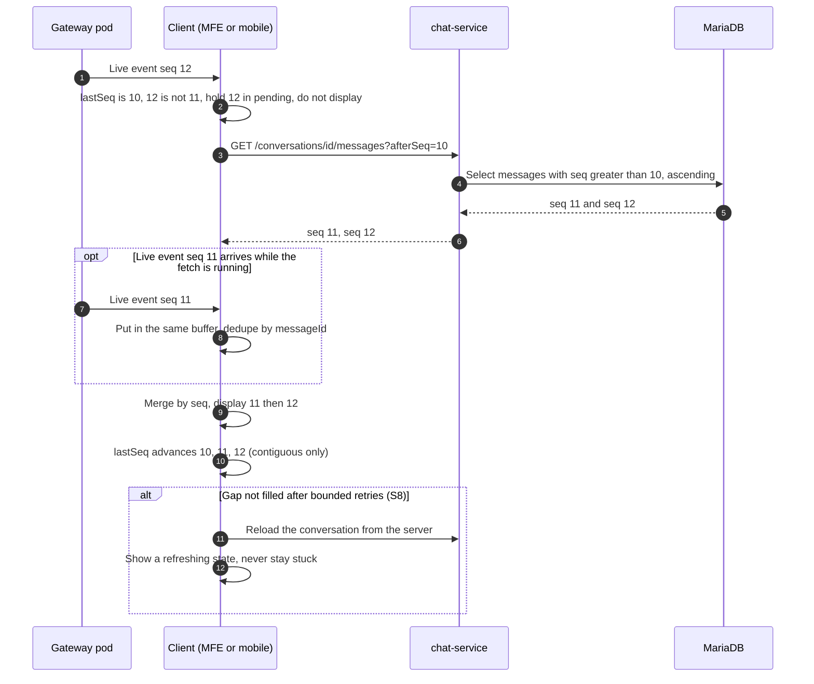
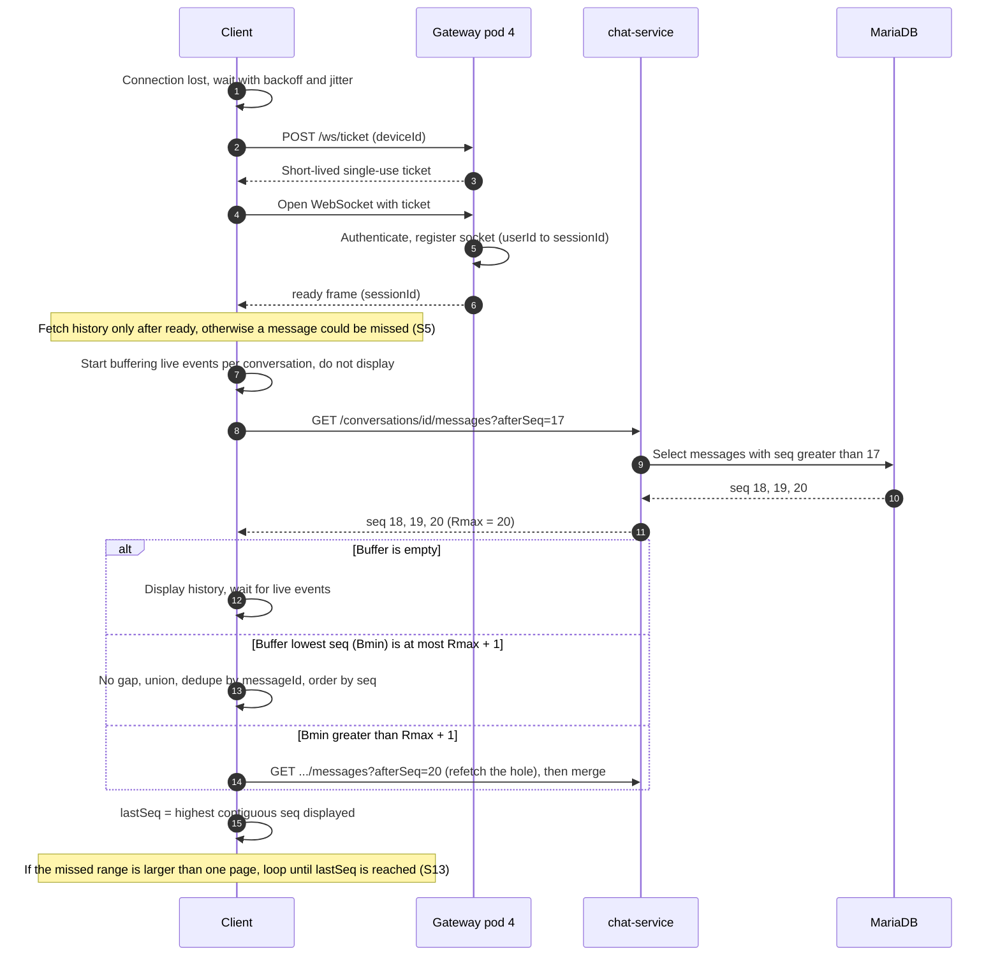
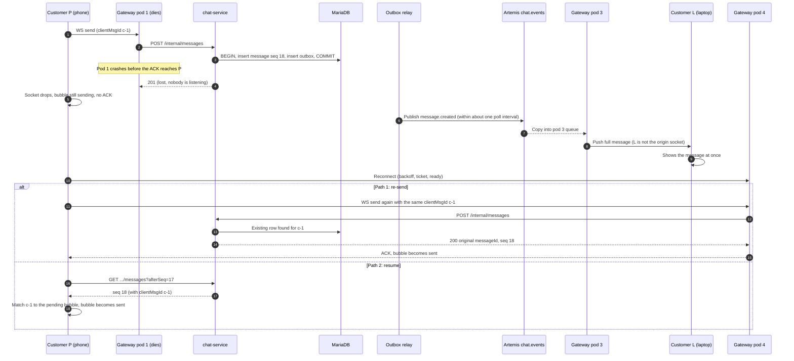
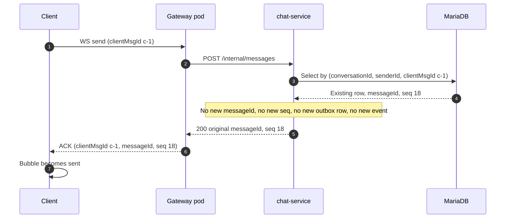
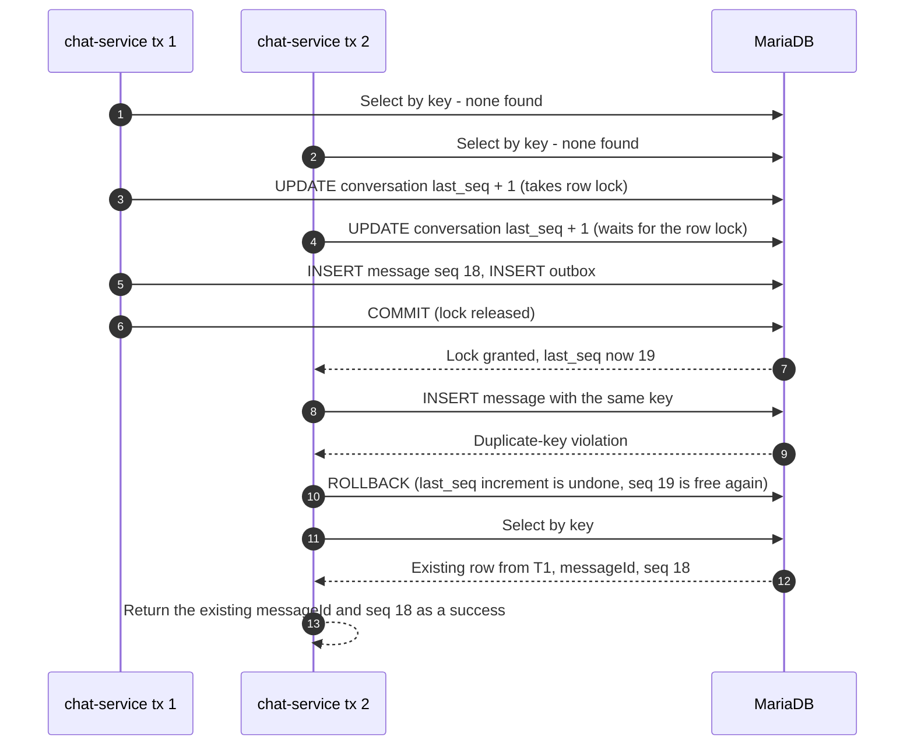
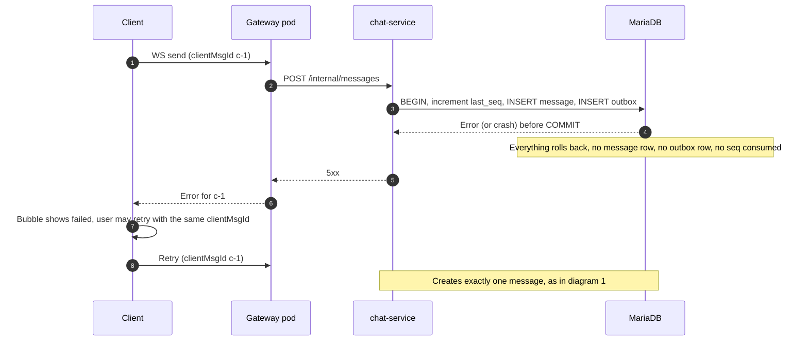
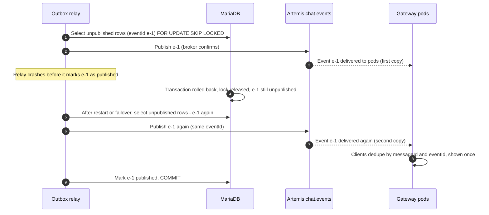

# Sequence Diagrams

One diagram per use case, added as we discuss each one. Diagrams use Mermaid (renders on GitHub and in most Markdown viewers). Rules and reasoning live in `docs/design-decisions.md` (D#) and the spec's "Client sync protocol" checks (S#); this file shows the order of events.

**Cast**
- *Customer P*: the customer's phone (device P), connected to gateway pod G1.
- *Customer L*: the same customer's laptop, connected to gateway pod G3.
- *RM*: the relationship manager's browser, connected to gateway pod G2.
- *Gateway Gn*: ws-gateway pod n. Holds sockets, never publishes chat events (D5).
- *CS*: chat-service. *Relay*: the outbox relay inside chat-service (D6, D8).
- *DB*: MariaDB. *MQ*: Artemis, address `chat.events`, multicast, one queue per gateway pod (D14).

Contents
1. Send a message, both users online (happy path)
2. Delivered receipt back to the sender
3. Live gap detected by the client (seq 10 then 12)
4. Reconnect after a pod restart (sync protocol)
5. Origin pod dies after the commit, before the ACK
6. Client re-sends an already stored message
7. Concurrent duplicate sends (S17)
8. DB commit fails
9. Relay publishes, but fails to mark the row (duplicate publish)

---

## 1. Send a message, both users online (happy path)

Checks: spec S2. Decisions: D3, D4, D5, D14, D16.

What to notice
- The ACK in step 11 depends only on the DB commit. The relay and the broker are not in the sender's wait.
- Every pod gets every event (Phase 1 broadcast). Only the pod holding a matching socket delivers.
- Nothing is published unless the outbox row was committed with the message.

---

## 2. Delivered receipt back to the sender

"Delivered" means the recipient's device received the message and its app acknowledged it. It is not the echo of the original event. Decisions: D14, spec section C and D.

What to notice
- Delivered and read travel the same route as messages: database first, then outbox, then broker.
- "Read" works the same way, using `lastReadSeq` (monotonic, never moves backwards).

---

## 3. Live gap detected by the client (seq 10 then 12)

Checks: S6, S7, S8. Decision: D17. The client has shown messages up to seq 10 in an open conversation.

What to notice
- 12 is never shown before 11.
- If 12 exists in the database then 11 does too, because `seq` is assigned under the conversation row lock (D16).

---

## 4. Reconnect after a pod restart (sync protocol)

Checks: S1 to S5, S9, S13, S16. Decision: D17. The client's pod restarted. It reconnects, with backoff and jitter, to a different pod and holds `lastSeq = 17` for the open conversation.

What to notice
- The broker is not involved in recovery. The database is the source of truth.
- Overlap between REST and live events is harmless. A gap is not.

---

## 5. Origin pod dies after the commit, before the ACK

Checks: S10. Decisions: D4, D9, D16. Customer P sent c-1. Pod 1 died after chat-service committed, so P never saw the ACK. The customer's laptop L stays connected on pod 3.

What to notice
- Nothing in the delivery path depended on pod 1. The relay published from the database.
- Both recovery paths end in the same single message. Either one, or both, is safe.
- The new socket on pod 4 has a new `sessionId`, so it may also receive the full message. The client dedupes by `clientMsgId` and `messageId`.

---

## 6. Client re-sends an already stored message

Checks: S12. Decision: D9. The server has the message. The client does not know, so it sends again with the same `clientMsgId`.

What to notice
- A duplicate request returns the original and creates nothing.
- The recipient can therefore never get a second copy from a re-send.

---

## 7. Concurrent duplicate sends (S17)

Checks: S17. Decisions: D9, D16. Two requests carry the same `clientMsgId` and reach chat-service almost together: the original request still in flight after its pod died, plus the client's re-send. T1 and T2 are two transactions.

What to notice
- The unique key is the real guard. The initial "select by key" is only a fast path.
- The duplicate-key error must never reach the user as an error.
- The rollback releases the counter increment, so `seq` stays gap-free.

---

## 8. DB commit fails

Checks: S11. Decisions: D3, D4. Nothing was stored, so nothing may be published.

What to notice
- No phantom event: the outbox row is part of the same transaction.
- A retry is safe because the id is the same and nothing was stored.

---

## 9. Relay publishes, but fails to mark the row (duplicate publish)

Checks: duplicate handling. Decisions: D4, D8, D9. At-least-once in action: the broker got the event but the relay crashed before marking the row.

What to notice
- The window between "publish" and "mark" cannot be removed, because two systems are involved. So duplicates are expected and absorbed.
- A republish reuses the same `eventId`, which is what makes de-duplication possible (D16).
- The leader lock (ShedLock) keeps this to one relay at a time. `SKIP LOCKED` and the dedupe are the safety nets underneath (D8).
